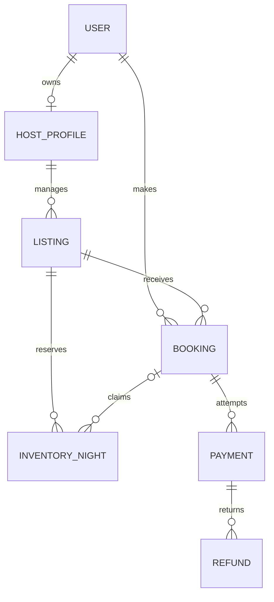

# Database contracts

This document describes the target PostgreSQL model. SQL migrations are a separate milestone.

- User holds identity and explicit roles. Session and verification tables follow the selected auth adapter. Host profile stores operational eligibility separately from public attribution.
- Listing holds classification, location and IANA timezone, capacity, stay limits, base price, and publication status. Listing media and amenities are child records. Separate exact address from the public city/region projection.
- Inventory night uses listing ID and local date as its key. A row belongs to a host block or a booking. Cancellation and expiry delete only the booking's claim rows in the same transaction as the state update.
- Booking links guest and listing, stores check-in and checkout dates, expiry, transition version, and immutable itemized price snapshot. Unique guest-scoped idempotency keys protect hold retries.
- Payment links booking and provider order with unique provider references. Payment events have unique provider event IDs. Refunds use separate provider references and append-only outcomes.
- Wishlist uniquely pairs user and listing. Review uniquely references an eligible completed booking. Notifications use event-scoped deduplication. Audit records reference actor, action, target, and request correlation ID.

Migration sequencing belongs to Agent A. Verify booking constraints against PostgreSQL and exercise simultaneous conflicting writes before enabling integrated reservations.
